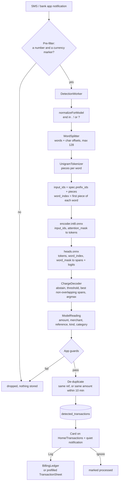

# Subsy architecture

How the app is put together and why. [PRD.md](PRD.md) says what the app does, and [DESIGN.md](DESIGN.md) covers the visual system. Most of this file is about charge detection, the most involved part of the app.

Package: `com.wolfeleo2.subsy` (PRD.md still says `.app`). Android 13+, Compose with Material 3 Expressive, MVVM, Room, WorkManager, DataStore. It's distributed through GitHub releases (sideloaded), not Play.

---

## 1. The app in one page

```
com.wolfeleo2.subsy
├── SubsyApplication     manual DI: lazy repositories, one per process
├── MainActivity         mode chooser on first launch, then SubsyNavGraph; refreshes exchange rates
├── data
│   ├── local            Room: entities, DAOs, SubsyDatabase (v4, exported schemas in app/schemas)
│   ├── model            domain types (Subscription, Transaction, Money, SpendCategory, AppMode, ...)
│   ├── repository       Subscription, PaymentRecord, Transaction, Category, Budget, Settings, ExchangeRate,
│   │                    BillingLedger, TransactionDetector (phase 5, not wired yet)
│   ├── catalog          PresetServiceCatalog (50+ services, keywords for matching)
│   └── util             Amounts, Dates, ExpenseCalculations
├── detection            on-device charge reading (section 2)
├── worker               DailyWorker: reminders, then auto-logging due charges
└── ui                   one package per screen, plus components/, navigation/, theme/
```

### Rules that hold the app together
Each of these came from a real bug or a decision. Breaking one brings the bug back.

- **Dependency injection is manual.** Repositories are lazy properties on `SubsyApplication`. Workers, receivers and services get them through `applicationContext as SubsyApplication`. Never build a repository in a composable.
- **Status is the source of truth.** `Subscription.status` (`TRIAL` means trialing now). `isFreeTrial` is history only, and `monthlyBurnRate` counts `ACTIVE` subscriptions only.
- **Billing dates come from a fixed anchor.** `startDate` never changes; the next date is `BillingCycle.nextBillingAfter(anchor, after)`. Never chain `plusMonths`, because month ends drift.
- **`BillingLedger` is the only place a charge is logged.** It writes the `PaymentRecord`, converts a paid trial to `ACTIVE` and advances the billing date as one operation. The detail screen, the daily worker and (later) detection confirmations all go through it.
- **Room never loses data.** `exportSchema = true`, no destructive fallback. Every schema change needs a version bump, an `AutoMigration` entry and a `MigrationTest` case. Inserts use plain `@Insert`, because `REPLACE` on a parent table cascade-deletes its payment records.
- **Money carries its currency.** Totals convert into the primary currency at read time (`inCurrency`, `Money.convertTo`) with keyless open.er-api.com rates, cached for 24 h. A stored amount is never rewritten. An amount with no rate is left out and flagged, never read as the primary currency.
- **Two modes, one dataset.** `AppMode.SUBSCRIPTIONS` hides the transaction screens; `ALL_SPENDING` adds transactions, income, categories and budgets. Switching never deletes anything.
- **ViewModel events** use `Channel(BUFFERED).receiveAsFlow()`, with compare-and-set guards against double taps.
- **The database is excluded from cloud backup** (`backup_rules.xml`, `data_extraction_rules.xml`), because detection will store message text.

### Background work
`DailyWorker` runs once a day around 08:00 (unique periodic work, `KEEP`). It sends reminders 3 days, 1 day and 0 days before a charge, then calls `BillingLedger.settleDue()`. That auto-logs every due cycle of each `ACTIVE` subscription. Trials are never charged automatically.

---

## 2. Charge detection (phase 5)

Read bank and mobile money messages (SMS and app notifications) on the phone and offer one-tap logging: *"Spotted KES 1,100 to Netflix. Log it?"*. It's opt-in, and nothing leaves the device.

### Status (2026-10-14)
| Part | State |
|---|---|
| Model choice, training, eval | Done: `eval/` |
| Export to ONNX and proof of equivalence | Done: `eval/reference.py`, `eval/unigram.py` |
| Kotlin port (split, tokenize, decode, ONNX wrapper) | Done: `app/.../detection/`, JVM tests pass |
| `ChargeModel` running on a phone | Written, **not yet run on a device** |
| Model download, SMS receiver, notification listener, Room v5, confirm card, onboarding | Not started; planned below |

### Why a small fine-tuned model, not rules and not an LLM
The user wanted detection that works outside Kenya without per-country rules, tells money in from money out, and suggests categories. Every candidate was scored by the same eval (`eval/run_eval.py`) on 42 messages: 14 real Kenyan SMS plus 28 synthetic ones, including other countries and non-money texts. The pass bar was kind ≥ 90%, exact amount ≥ 95% and zero false positives.

| Candidate | Kind | Amount | False positives | Speed (M1 CPU) | Download |
|---|---|---|---|---|---|
| Qwen3 0.6B, 4-bit, prompted | 81% | 94% | 2 | 3.7 s | 378 MB |
| GLiNER2.5 small, untrained | 69% | 91% | 5 | 0.07 s | 296 MB |
| **GLiNER2.5 small, fine-tuned, int8 encoder** | **95%** | **100%** | **0** | **0.04 s** | **~97 MB** |

Why the chosen model works:
- **It extracts spans.** GLiNER (`fastino/gliner2.5-small-v1`, Apache 2.0, 74M parameters) returns pieces of the message, so it can't invent an amount the way a generative model can.
- **It does both jobs in one pass.** One forward pass extracts the spans and classifies the message.
- **Fine-tuning taught it the formats.** Training on 1,400 template messages covered which number is the amount (not the balance or the fee), where the merchant sits ("M-PESA CARD for account PAYPAL *NETFLIX"), and what reference codes look like.

### The pipeline



Steps D to J are built (`detection/`). The rest is planned.

### The model files: one export, never mixed
`eval/reference.py` writes these together, and they only work together:

| File | Size | What it is |
|---|---|---|
| `encoder.int8.onnx` | 87 MB | DeBERTa-v3-xsmall encoder, dynamic int8 **per-channel** quantization |
| `heads.onnx` | 5.9 MB | Everything after the encoder (boundary head and classifier) for our fixed schema, fp32 |
| `vocab.tsv` | 4.5 MB | Unigram vocabulary: `unk_id` and `min_score` rows, then `id  piece  score` rows |
| `spec.json` | ~45 KB | `prefix_ids` (the schema prompt as token ids), label order for kinds and categories, entity order, thresholds |

The schema is frozen at export: three entities (amount, merchant, reference) and two classifications (kind with 4 labels, category with 14). Changing any label, description or order means retraining, re-exporting and regenerating the test resources. The prompt is baked into `prefix_ids` and into marker positions inside `heads.onnx`.

### What the Kotlin code does (`app/src/main/java/com/wolfeleo2/subsy/detection/`)
| File | Role | Python it mirrors |
|---|---|---|
| `DetectorSpec.kt` | Parses `spec.json` | `capture_prefix` in `reference.py` |
| `Tokenization.kt` | `normalizeForModel`, `WordSplitter`, `UnigramTokenizer`, `encodeForModel` | `normalize`, `split_words`, `encode` in `reference.py`; `unigram.py` |
| `ChargeDecoder.kt` | Head outputs to `ModelReading` | `decode` and `best_flat` in `reference.py` |
| `ChargeModel.kt` | Loads the four files and runs both ONNX sessions | `run_onnx` in `reference.py` |

How it works, with the rules that are easy to get wrong:

1. **Normalize.** An empty message becomes `"."`. A message not ending in `.`, `!` or `?` gets `"."` appended with no space. gliner2 does this before training and inference, and skipping it changes token ids.
2. **Split.** The regex is gliner2's `WhitespaceTokenSplitter`: URLs, emails and `@handles` stay whole, letter or digit runs joined by `-` or `_` stay one word, and every other non-space character is its own word. Python's `\w` plus every combining mark is written `[\p{L}\p{N}\p{M}_‌‍]` in Java regex. Words are lowercased; offsets index the normalized text. At most 128 words.
   - Hyphen runs are one word. `2547****304-JOHN KAMAU` yields the merchant `2547****304-JOHN KAMAU`, so the app strips the masked-number prefix itself.
3. **Tokenize** each word as SentencePiece Unigram over `"▁" + NFC(word)`:
   - Viterbi on code points, picking the best total score.
   - A character no piece covers costs `min_score - 10` and becomes `unk`; consecutive `unk`s fuse into one.
   - Ties keep the first (strict `>`).
4. **Assemble.** `input_ids = prefix_ids + pieces`, and `word_index[i]` is the position of word i's first piece. Both are padded to 128 slots with 0 and a `false` mask. There's no `[CLS]`.
5. **Run.** The encoder produces `last_hidden_state`, which feeds `heads.onnx` together with `word_index` and `word_mask`.
6. **Decode** each entity:
   - Skip it if `sigmoid(null_logit) > 0.5`, meaning the model abstains.
   - Otherwise keep valid candidates with `sigmoid(logit) >= 0.5` inside the word range; the same bounds twice keep the max.
   - Choose the **maximum-total-score set of non-overlapping spans**. This is weighted interval scheduling, not greedy best-first. gliner2's "flat" policy works this way.
   - Order by score.
   - The text is `message[words[s].start : words[e-1].end].trim()`.
   - Kind and category are the argmax of their logits.

### Proof that Kotlin, Python and gliner2 agree
| Link | Check | Result |
|---|---|---|
| gliner2 `extract()` and `reference.py` (torch) | `reference.py`: input ids and outputs on 342 messages | 342/342 identical |
| `reference.py` torch and the ONNX graphs (fp32) | same run | 342/342 identical |
| HF tokenizer and `unigram.py` | `unigram.py` on every distinct word | 3,736/3,736 identical |
| Python and Kotlin split plus tokenize | `DetectionPortTest.splitsAndTokenizes...` on 1,400+ synthetic messages | passes |
| Python and Kotlin decode | `DetectionPortTest.decodesHeadOutputs...` on 47 fixtures | passes |
| ONNX on a phone | none yet | **not checked**; add an androidTest once the files can be on a device |

The int8 encoder is not bit-identical to fp32. On 342 messages it changed 10 kinds and 8 categories, and never an amount. Plain (per-tensor) int8 changed 30 kinds, so `onnx_encoder.py` uses per-channel quantization.

### App-side guards (planned; behaviour from `eval/run_eval.py`)
The model reads, and the app decides what to trust:
- **Amount:** the amount's numeric value must be one of the numbers in the message.
- **Currency:** the currency marker (ISO code, or an alias such as Ksh, $, €, £, Rs, ₦) must be in the message.
- **References:** each one must appear in the message, and they drive de-duplication. KCB sends two SMS for one transfer, and SMS sometimes arrive twice.
- **Own transfers:** a counterparty equal to the account holder's name (a Settings field) means a transfer between their own accounts.
- **Subscriptions:** matched by name in code, against the user's subscriptions and catalog keywords.
- **Category:** comes from merchant memory first (what the user picked last time for this merchant). The model's category is only a first guess (80% on the eval).
- **No auto-logging:** detections are never logged automatically. Confirming goes through `BillingLedger`. If the daily worker already auto-logged that cycle, the confirmation upgrades that record instead of adding a second one.

### Privacy
- **On-device only.** Messages are read and parsed on the phone, and nothing is sent anywhere. Only messages that pass the pre-filter are stored, and the database is excluded from backups.
- **`eval/` is private.** `messages.txt` and `labels.jsonl` contain the developer's real SMS, with names and phone numbers. They and `eval/artifacts/` are in `.gitignore`. Never publish them.
- **Test resources are synthetic.** `app/src/test/resources/detection/` is generated by `eval/export_app.py` from synthetic texts only, and is safe to commit. Pass only synthetic files to that script, and check that no real names slip into synthetic templates.

### Retraining or changing the model
Use any Python 3.12 virtualenv: `uv venv --python 3.12 && uv pip install "gliner2[local]" onnx onnxruntime onnxscript`. Run the scripts with `python -I`. Download the base model with plain `curl` from `huggingface.co/fastino/gliner2.5-small-v1/resolve/main/<file>`; the `hf` client stalled.

```sh
# 1. Training data from templates (refuses any text that is in the eval set)
python -I eval/make_train.py eval/labels.jsonl eval/train2.jsonl 800
# 2. Fine-tune (base: the downloaded model, or a previous checkpoint). ~15 min on an M1 CPU.
python -I eval/train_gliner.py eval/train2.jsonl <base dir> <out dir> [epochs]
# 3. Score it; add an encoder .onnx as a third argument to score the int8 version.
#    EVAL_OWNER is the account holder's name (the own-transfer rule); it stays out of the repo.
EVAL_OWNER="Your Name" python -I eval/run_eval.py eval/labels.jsonl <out dir>/best
# 4. Export encoder (int8) + heads + spec, and check equivalence against gliner2
python -I eval/reference.py <out dir>/best eval/artifacts/detector eval/labels.jsonl eval/train2.jsonl
#    then copy tokenizer.json and tokenizer_config.json from <out dir>/best into eval/artifacts/detector
# 5. Check the tokenizer spec
python -I eval/unigram.py eval/artifacts/detector/tokenizer.json eval/labels.jsonl eval/train2.jsonl
# 6. Golden cases and app test resources (synthetic texts only)
python -I eval/fixtures.py eval/artifacts/detector eval/artifacts/detector/fixtures.jsonl <synthetic.jsonl>
python -I eval/export_app.py eval/artifacts/detector app/src/test/resources <synthetic.jsonl> eval/train.jsonl eval/train2.jsonl
# 7. Kotlin still matches
./gradlew :app:testDebugUnitTest --tests "com.wolfeleo2.subsy.detection.*"
```

To support a new country, add real-format templates to `make_train.py` and a few labelled messages to `labels.jsonl`, then retrain. That's data, not code.

### Traps found along the way
- **The gliner2 README's training API is out of date.** Use `TrainingDataset.validate(raise_on_error=...)` and `ExtractorTrainer.train(train_data=..., eval_data=...)`.
- **Training labels must align with tokens.** An entity value inside a hyphen run fails alignment; check with `processor.find_unalignable_entities`.
- **Heads export:**
  - The legacy exporter can't handle the head's sorts, so it uses `dynamo=True`.
  - The head specializes on the word count, which is why words are padded to a fixed 128.
  - ONNX has no stable sort, so `stable=True` is stripped during export. Only exact ties are affected, and decode doesn't depend on candidate order.
- **Export leaves modules in training mode.** Call `.eval()` again before comparing, or dropout makes the reference look wrong.
- **Quantize only the encoder.** Quantizing the heads too dropped agreement to 266/342.
- **Watch for overflow in decode.** Masked candidates carry logits near -1e9. `ChargeDecoder` computes the sigmoid in float, where `exp` overflows to infinity and the probability correctly becomes 0.

### Open decisions
- **APK size: decided 2026-10-14, 64-bit ARM only.** onnxruntime-android ships a native library per ABI. With all four, the debug APK went from 109 MB to 248 MB.
  - `ndk.abiFilters = arm64-v8a` in `app/build.gradle.kts` brings it to 142 MB (+33 MB). This drops 32-bit phones and x86 emulators.
  - If 32-bit Android Go phones matter later, ship per-ABI APK splits rather than a fat APK. A reduced-operator ONNX Runtime build is the other lever.
- **Hosting the model files.** A GitHub release asset per export, with SHA-256 checksums in the app. Apache 2.0 attribution for GLiNER2.5 and DeBERTa-v3.
- **Message length.** Messages beyond 128 words are cut, as gliner2 does. Every bank SMS seen so far is under 70 words.
