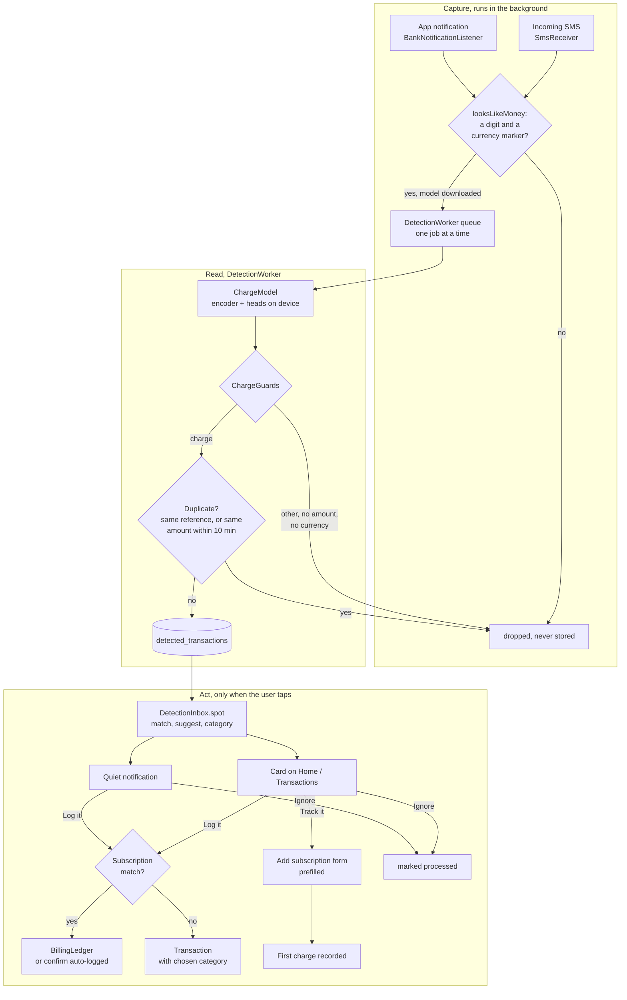
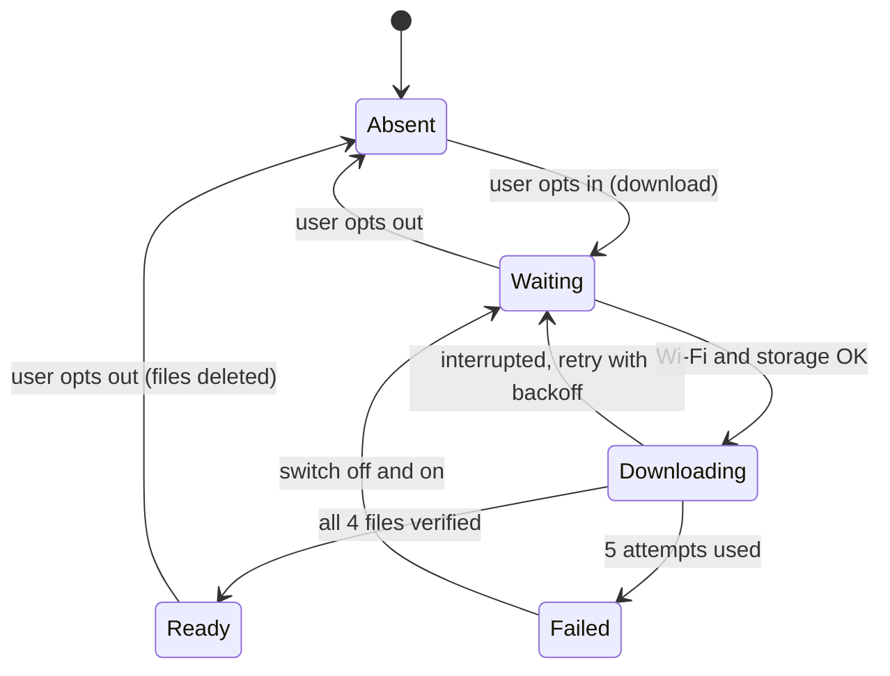
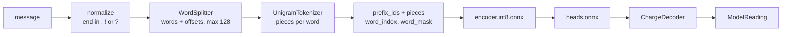
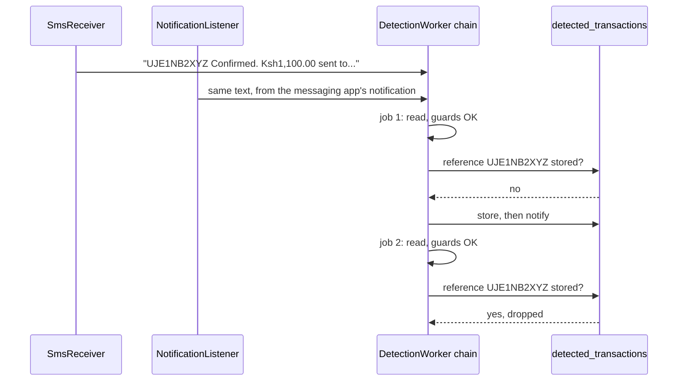
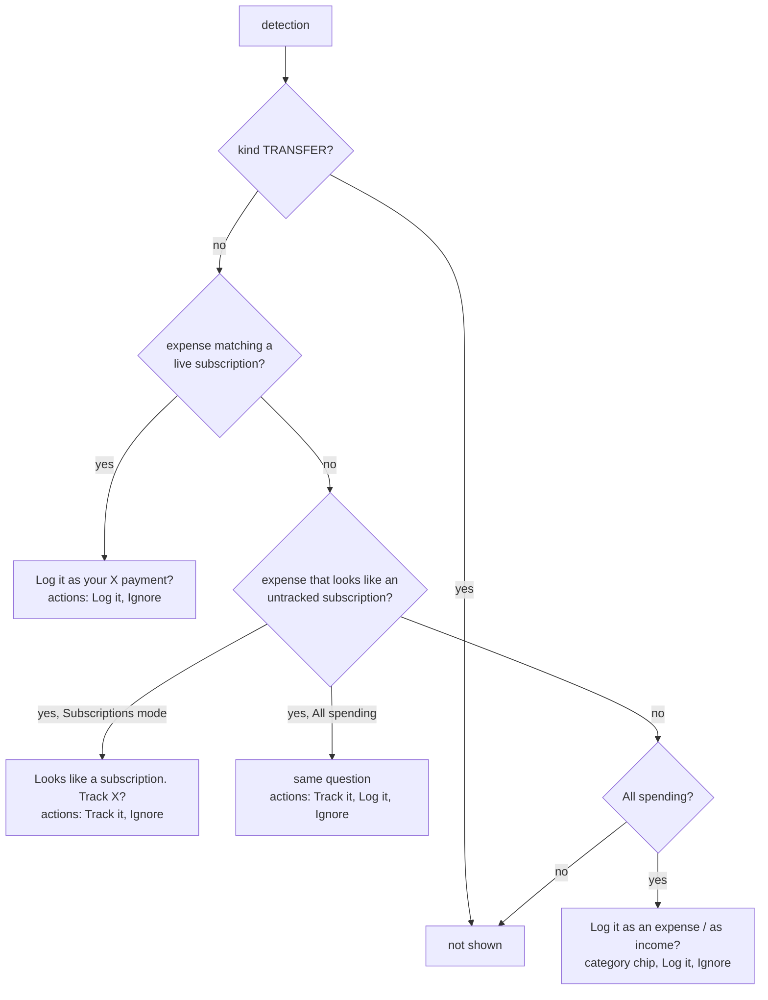
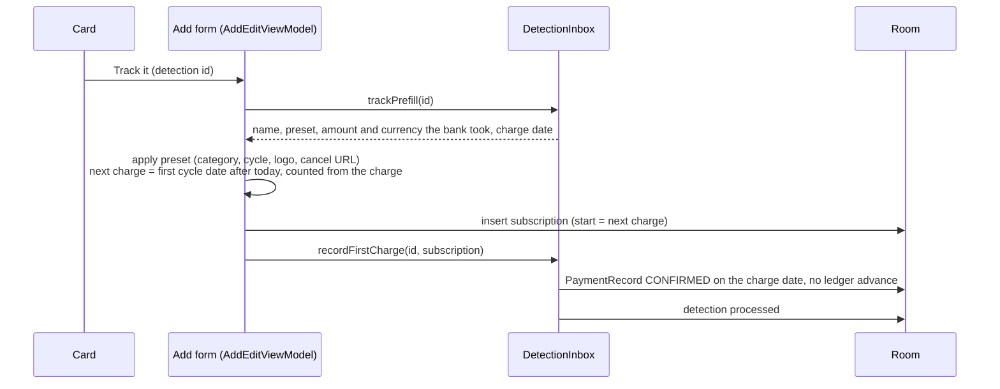
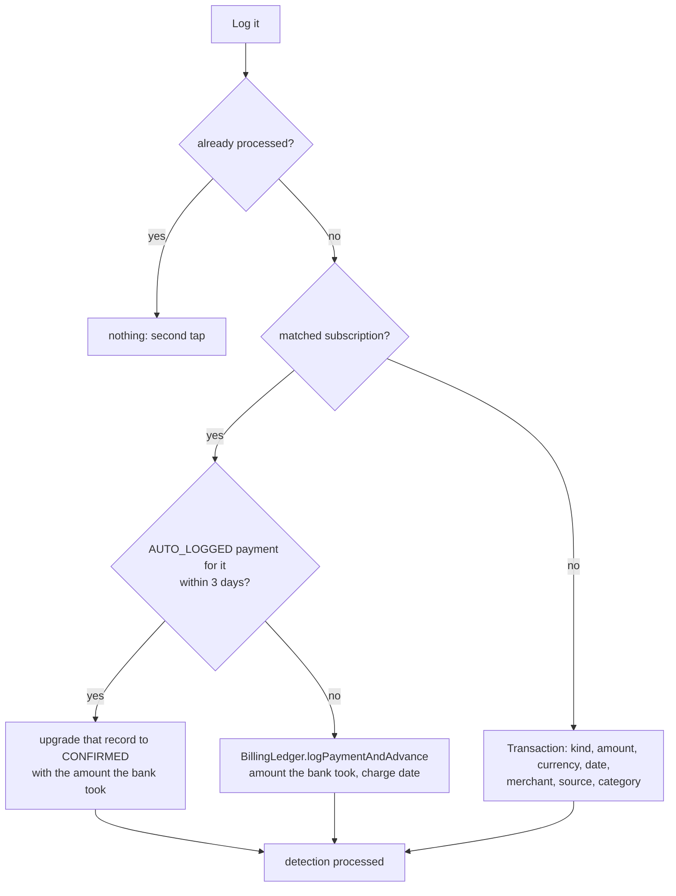

# Subsy architecture

How the app is put together and why. [PRD.md](PRD.md) says what the app does, and [DESIGN.md](DESIGN.md) covers the visual system. Most of this file is about charge detection (section 2), the most involved part of the app. Everything about that phase lives here: how it works, why it was built this way, how to test it and how to change the model.

Package: `com.wolfeleo2.subsy` (PRD.md still says `.app`). Android 13+, Compose with Material 3 Expressive, MVVM, Room, WorkManager, DataStore. It's distributed through GitHub releases (sideloaded), not Play. Public repo: `WolfeLeo2/Subsy`.

---

## 1. The app in one page

```
com.wolfeleo2.subsy
├── SubsyApplication     manual DI: lazy repositories, one per process
├── MainActivity         mode chooser, then the one-time detection screen, then SubsyNavGraph
├── data
│   ├── local            Room: entities, DAOs, SubsyDatabase (v5, exported schemas in app/schemas)
│   ├── model            domain types (Subscription, Transaction, Money, SpendCategory, DetectedTransaction, ...)
│   ├── repository       Subscription, PaymentRecord, Transaction, Category, Budget, Settings, ExchangeRate,
│   │                    BillingLedger, TransactionDetector, DetectionInbox
│   ├── catalog          PresetServiceCatalog (57 services, keywords for matching)
│   └── util             Amounts, Dates, ExpenseCalculations
├── detection            on-device charge reading: model, capture, guards, model download (section 2)
├── worker               DailyWorker (reminders, auto-logging), DetectionWorker, ModelDownloadWorker, notifiers
└── ui                   one package per screen, plus components/, detection/, navigation/, theme/
```

### Rules that hold the app together
Each of these came from a real bug or a decision. Breaking one brings the bug back.

- **Dependency injection is manual.** Repositories are lazy properties on `SubsyApplication`. Workers, receivers and services get them through `applicationContext as SubsyApplication`. Never build a repository in a composable.
- **Status is the source of truth.** `Subscription.status` (`TRIAL` means trialing now). `isFreeTrial` is history only, and `monthlyBurnRate` counts `ACTIVE` subscriptions only.
- **Billing dates come from a fixed anchor.** `startDate` never changes; the next date is `BillingCycle.nextBillingAfter(anchor, after)`. Never chain `plusMonths`, because month ends drift.
- **`BillingLedger` logs charges.** It writes the `PaymentRecord`, converts a paid trial to `ACTIVE` and advances the billing date as one operation. The detail screen, the daily worker and detection all go through it. There are exactly two deliberate exceptions, both in `DetectionInbox` and both to keep the billing date from advancing twice:
  - Confirming a cycle the daily worker already auto-logged upgrades that record in place.
  - Tracking a new subscription from a charge records that charge directly, because the add form already set the next charge one cycle later.
- **Room never loses data.** `exportSchema = true`, no destructive fallback. Every schema change needs a version bump, an `AutoMigration` entry and a `MigrationTest` case. Inserts use plain `@Insert`, because `REPLACE` on a parent table cascade-deletes its payment records.
- **Money carries its currency.** Totals convert into the primary currency at read time (`inCurrency`, `Money.convertTo`) with keyless open.er-api.com rates, cached for 24 h. A stored amount is never rewritten. An amount with no rate is left out and flagged, never read as the primary currency.
- **Two modes, one dataset.** `AppMode.SUBSCRIPTIONS` hides the transaction screens; `ALL_SPENDING` adds transactions, income, categories and budgets. Switching never deletes anything.
- **ViewModel events** use `Channel(BUFFERED).receiveAsFlow()`, with compare-and-set guards against double taps.
- **The database is excluded from cloud backup** (`backup_rules.xml`, `data_extraction_rules.xml`), because detection stores message text.

### Background work
| Worker | When | What |
|---|---|---|
| `DailyWorker` | Daily around 08:00 (unique periodic, `KEEP`) | Reminders 3, 1 and 0 days before a charge, then `BillingLedger.settleDue()`, which auto-logs every due cycle of each `ACTIVE` subscription. Trials are never charged automatically. |
| `ModelDownloadWorker` | When the user opts in to detection (unmetered network) | Downloads and verifies the detector files (section 2.4). |
| `DetectionWorker` | One job per captured message, run in sequence | Reads the message with the model and stores it if it passes the guards (section 2.7). |

---

## 2. Charge detection (phase 5)

Read bank and mobile money messages (SMS and app notifications) on the phone and offer one-tap logging: *"Spotted KES 1,100.00 to Netflix. Log it as your Netflix payment?"*. It's opt-in, nothing is logged without a tap, and messages never leave the device.

### 2.1 Status (2026-10-14)
| Part | State |
|---|---|
| Model: chosen, fine-tuned, evaluated (`eval/`) | Done |
| ONNX export, proof of equivalence with gliner2 | Done (342/342) |
| Kotlin port: split, tokenize, decode, ONNX wrapper | Done; JVM tests and the device test pass (0/47 differ on an S22) |
| Model download and the Settings opt-in | Done; release `detector-v1` published |
| Capture: SMS receiver, notification listener, pre-filter, `DetectionWorker`, guards, de-duplication, Room v5 | Done; a real M-Pesa airtime SMS was detected and logged on the S22 |
| Card, notification, logging, matching, merchant memory, own-account rule, onboarding | Done; unit-tested |
| Track it (suggest untracked subscriptions), category picker on the card | Done; unit-tested, not yet tried on a device |

### 2.2 The whole feature on one page



### 2.3 Why a small fine-tuned model, not rules and not an LLM
The goal was detection that works outside Kenya without per-country rules, tells money in from money out, and suggests categories. Every candidate was scored by the same eval (`eval/run_eval.py`) on 42 messages: 14 real Kenyan SMS plus 28 synthetic ones, including other countries and non-money texts. The pass bar was kind at least 90%, exact amount at least 95% and zero false positives.

| Candidate | Kind | Amount | False positives | Speed (M1 CPU) | Download |
|---|---|---|---|---|---|
| Qwen3 0.6B, 4-bit, prompted | 81% | 94% | 2 | 3.7 s | 378 MB |
| GLiNER2.5 small, untrained | 69% | 91% | 5 | 0.07 s | 296 MB |
| **GLiNER2.5 small, fine-tuned, int8 encoder** | **95%** | **100%** | **0** | **0.04 s** (82 ms on the S22) | **~98 MB** |

Why the chosen model works:
- **It extracts spans.** GLiNER (`fastino/gliner2.5-small-v1`, Apache 2.0, 74M parameters) returns pieces of the message, so it can't invent an amount the way a generative model can.
- **It does both jobs in one pass.** One forward pass extracts the spans and classifies the message.
- **Fine-tuning taught it the formats.** Training on 1,400 template messages covered which number is the amount (not the balance or the fee), where the merchant sits ("M-PESA CARD for account PAYPAL *NETFLIX") and what reference codes look like.

What a model can't decide well from one message is left to code that has more evidence: whether a charge is a subscription (section 2.10), which of the user's own categories fits (section 2.11), and whether money moved between the user's own accounts (section 2.8).

### 2.4 The model files: one export, never mixed
`eval/reference.py` writes these together, and they only work together:

| File | Size | What it is |
|---|---|---|
| `encoder.int8.onnx` | 87 MB | DeBERTa-v3-xsmall encoder, dynamic int8 **per-channel** quantization |
| `heads.onnx` | 5.9 MB | Everything after the encoder (boundary head and classifier) for our fixed schema, fp32 |
| `vocab.tsv` | 4.5 MB | Unigram vocabulary: `unk_id` and `min_score` rows, then `id  piece  score` rows |
| `spec.json` | ~45 KB | `prefix_ids` (the schema prompt as token ids), label order for kinds and categories, entity order, thresholds |

The schema is frozen at export: three entities (amount, merchant, reference) and two classifications (kind with 4 labels, category with 14). Changing any label, description or order means retraining, re-exporting and regenerating the test resources. The prompt is baked into `prefix_ids` and into marker positions inside `heads.onnx`. `ChargeGuards` maps the label strings of `detector-v1` to app types, so new labels need it updated too.

**How the files reach the phone:**
- **Opt-in only.** Turning detection on (onboarding or Settings) stores `detection_enabled` in DataStore and calls `ModelRepository.download()`. Turning it off calls `remove()`, which cancels the work and deletes the files.
- **Source.** GitHub release assets on `WolfeLeo2/Subsy`. Tag, size and SHA-256 per file are in `DetectorRelease`.
- **Worker.** `ModelDownloadWorker` is unique work that runs only on unmetered networks with storage not low.
  - Each file streams into `<name>.part` and resumes with an HTTP `Range` after an interruption.
  - It's renamed into place only when its size and SHA-256 match, so "file present" means "verified".
  - Network errors and checksum failures retry with backoff, up to 5 attempts, then the state becomes Failed.
  - No foreground service: a run stopped at WorkManager's 10-minute limit resumes from the bytes on disk.
- **Storage.** `noBackupFilesDir/detector/<tag>/`, never in cloud backups. Older tags are deleted when a download starts.



To publish a new export:
1. `gh release create detector-vN eval/artifacts/detector/{spec.json,vocab.tsv,heads.onnx,encoder.int8.onnx}`.
2. Update `DetectorRelease.TAG` and the sizes and hashes (`shasum -a 256`).
3. Regenerate the test resources (step 6 under 2.15).

### 2.5 Reading one message (`detection/`)
| File | Role | Python it mirrors |
|---|---|---|
| `DetectorSpec.kt` | Parses `spec.json` | `capture_prefix` in `reference.py` |
| `Tokenization.kt` | `normalizeForModel`, `WordSplitter`, `UnigramTokenizer`, `encodeForModel` | `normalize`, `split_words`, `encode` in `reference.py`; `unigram.py` |
| `ChargeDecoder.kt` | Head outputs to `ModelReading` | `decode` and `best_flat` in `reference.py` |
| `ChargeModel.kt` | Loads the four files and runs both ONNX sessions (about 1.4 s to load, 82 ms per message on the S22) | `run_onnx` in `reference.py` |



The steps, with the rules that are easy to get wrong:

1. **Normalize.** An empty message becomes `"."`. A message not ending in `.`, `!` or `?` gets `"."` appended with no space. gliner2 does this before training and inference, and skipping it changes token ids.
2. **Split.** The regex is gliner2's `WhitespaceTokenSplitter`: URLs, emails and `@handles` stay whole, letter or digit runs joined by `-` or `_` stay one word, and every other non-space character is its own word.
   - Every character class is spelled out. Android's ICU regex rejects `UNICODE_CHARACTER_CLASS`, and without it `\s` means ASCII whitespace on the JVM but Unicode whitespace on Android. Whitespace is Python's `str.isspace()` set; a word character is `[\p{L}\p{N}\p{M}_\u200C\u200D]`.
   - Words are lowercased; offsets index the normalized text. At most 128 words.
   - Hyphen runs are one word. `2547****304-JOHN KAMAU` yields that whole run as the merchant, so the guards strip the masked-number prefix.
3. **Tokenize** each word as SentencePiece Unigram over `"▁" + NFC(word)`:
   - Viterbi on code points, picking the best total score.
   - A character no piece covers costs `min_score - 10` and becomes `unk`; consecutive `unk`s fuse into one.
   - Ties keep the first (strict `>`).
4. **Assemble.** `input_ids = prefix_ids + pieces`, and `word_index[i]` is the position of word i's first piece. Both are padded to 128 slots with 0 and a `false` mask. There's no `[CLS]`.
5. **Run.** The encoder produces `last_hidden_state`, which feeds `heads.onnx` together with `word_index` and `word_mask`.
6. **Decode** each entity:
   - Skip it if `sigmoid(null_logit) > 0.5`, meaning the model abstains.
   - Otherwise keep valid candidates with `sigmoid(logit) >= 0.5` inside the word range; the same bounds twice keep the max.
   - Choose the **maximum-total-score set of non-overlapping spans**. This is weighted interval scheduling, not greedy best-first. gliner2's "flat" policy works this way.
   - Order by score. The text is `message[words[s].start : words[e-1].end].trim()`.
   - Kind and category are the argmax of their logits. The sigmoid is computed in float, where masked logits near -1e9 overflow `exp` to infinity and correctly give 0.

### 2.6 Proof that Kotlin, Python and gliner2 agree
| Link | Check | Result |
|---|---|---|
| gliner2 `extract()` and `reference.py` (torch) | `reference.py`: input ids and outputs on 342 messages | 342/342 identical |
| `reference.py` torch and the ONNX graphs (fp32) | same run | 342/342 identical |
| HF tokenizer and `unigram.py` | `unigram.py` on every distinct word | 3,736/3,736 identical |
| Python and Kotlin split plus tokenize | `DetectionPortTest.splitsAndTokenizes...` on 1,400+ synthetic messages | passes |
| Python and Kotlin decode | `DetectionPortTest.decodesHeadOutputs...` on 47 fixtures | passes |
| Python and ONNX on a phone | `ChargeModelDeviceTest` (androidTest) on the 47 fixtures | 0/47 differ on an S22 |

The int8 encoder is not bit-identical to fp32. On 342 messages it changed 10 kinds and 8 categories, and never an amount. Plain (per-tensor) int8 changed 30 kinds, so `onnx_encoder.py` uses per-channel quantization.

### 2.7 Capture
| Piece | What it does |
|---|---|
| `SmsReceiver` | `SMS_RECEIVED` only (permission `RECEIVE_SMS`, no `READ_SMS`, so old messages are never read). Joins multi-part SMS per sender. Protected by `BROADCAST_SMS`, so only the system can call it. |
| `BankNotificationListener` | Every app's notifications once the user grants notification access. Reads the body only (the model was trained on bodies). Skips Subsy's own, ongoing and group-summary notifications, and a re-post with unchanged text. |
| `looksLikeMoney` (pre-filter, `ChargeGuards.kt`) | A digit and a currency marker. ISO codes count only in capitals (lowercase "all", "try", "top" are words); aliases and symbols (Ksh, KShs, Rs, $, £, €, ₦, ₹, ¥) count in any case. Anything else is dropped before it is stored or queued. |
| `DetectionWorker` | One appended work chain (`APPEND_OR_REPLACE`), so jobs run one at a time. Re-checks that detection is still on, runs the model, the guards and the duplicate check, stores, then posts the notification. Never returns failure, because a failed job would cancel every message queued behind it. |

Why one job at a time matters: Google Messages posts a notification for every SMS, so one charge usually arrives twice, once from each source.



**Background starts.** Android starts Subsy's process for the receiver, the listener and the worker without the app open. Swiping the app away is fine. Force stop blocks everything until the next launch (Android's rule). Samsung may put rarely used apps to sleep, so users who miss messages should add Subsy to *Never sleeping apps*.

### 2.8 Guards (`ChargeGuards.accept`)
The model reads, the app decides what to trust. A reading becomes a `DetectedCharge` only if:
- **Kind** is a money movement. "Promotion, code, loan, failed transaction or chat" is dropped.
- **Amount** parses from the amount span (`parseMessageAmount`: `Ksh1,100.00` is 1100, `23,40 EUR` is 23.4, `1.234,56` is 1234.56) and is above 0.
- **Currency** is found in the amount span, or else anywhere in the message. A bare `$` is read as USD.
- **Merchant** loses a leading masked number (`2547****304-`).
- **Reference** is one token of 6+ letters and digits, mixed. A junk "reference" like "KCB App" would match every KCB message and make real charges look like duplicates, so it's ignored.
- **Own transfers:** when every word of the user's name ("Your name on bank messages" in Settings) appears in the counterparty, in any order, the kind becomes TRANSFER. Transfers are stored but never shown.
- **Category** from the model is kept only if it fits the direction (no "salary" on an expense).

**De-duplication** (`TransactionDetectorRepository.isDuplicate`): the same reference ever seen, or, without a reference, the same amount and currency within 10 minutes either side.

### 2.9 Storage (Room v5)
`detected_transactions`: `id`, `merchant_name`, `amount`, `currency`, `kind` (EXPENSE, INCOME, TRANSFER), `reference` (indexed), `category_key` (the model's guess), `sender` (SMS address or app package), `raw_message`, `source` (SMS or NOTIFICATION), `detected_at`, `is_processed`. Version 5 added the columns after `is_processed` through `AutoMigration(4, 5)`; `MigrationTest.migrate4To5...` covers it and passed on the S22.

A row is processed once the user logs it, tracks it or ignores it. Processed rows stay as history: they feed de-duplication and the monthly-repeat check.

### 2.10 What the user sees, and Track it
`DetectionInbox.spot` decides, for each unprocessed detection, what it is and which actions fit the current mode:



| | Subscriptions mode | All spending mode |
|---|---|---|
| Matches a live subscription | Card on Home + notification: Log it, Ignore | Same |
| Looks like an untracked subscription | Card: Track it, Ignore. Notification: Ignore (tap opens the app) | Card: Track it, Log it, Ignore. Notification: Log it, Ignore |
| Other expense or income | Not shown | Card on Transactions with a category chip + notification: Log it, Ignore |
| Transfer between own accounts | Not shown | Not shown |

The card (`ui/detection/SpottedCharges.kt`) sits in a slot under the Home hero and under the Transactions month summary, and in the Transactions empty state. The notification (`DetectionNotifier`, channel "Spotted charges", low importance) uses the same words, from `SpottedWording.kt`. Its buttons go to `DetectionActionReceiver`, which isn't exported. Handling a charge anywhere cancels its notification, and `DetectionInbox.log` checks `is_processed` first, so tapping the card and then the notification logs once.

**Matching a tracked subscription** (`SubscriptionMatcher`): the subscription is live (ACTIVE or TRIAL) and its full name, the first word of its name (4+ letters), or the catalog keywords of the preset with its name appear in the merchant, ignoring case, spaces and punctuation. "YouTube Premium" matches "GOOGLE *YouTubePremium". Several matches: closest amount in the same currency wins.

**Suggesting an untracked subscription** (`SubscriptionSuggester`), only for expenses that match nothing tracked, from evidence rather than a guess:
1. **Catalog:** the merchant contains a preset's name or keyword (4+ letters). The longest matching key wins, so "GOOGLE *YouTubePremium" suggests YouTube Premium, not Google One.
2. **Monthly repeat:** the same merchant took an amount within 15% of this one 25 to 35 days earlier, in a stored detection or in the user's transactions.
3. A service the user already has, under any status (paused or cancelled too), is never suggested.

**Track it** opens the add form at `Screen.TrackSpottedCharge(detectionId)`:



Changing the billing cycle in the form recomputes the next charge from the detected charge, not from today. The first charge is recorded directly, not through the ledger, because the next charge is already one cycle ahead; the ledger would advance it again.

### 2.11 Logging and categories (`DetectionInbox.log`)


**The category** of a logged transaction, first that applies:
1. What the user picked on the card's category chip. The menu lists the built-in categories for that direction, the user's custom ones, and "New category" (the same dialog as the Categories screen).
2. **Merchant memory:** the category of the user's latest transaction of the same kind with the same merchant (case-insensitive), read straight from `transactions`, with no extra table. Every pick teaches it, so each merchant is corrected once.
3. The model's guess, if it fits the direction. Its 14 labels are fixed at export, so it can never pick a custom category; that's what 1 and 2 are for.
4. Other, or Other income.

The chip shows the result of 2 to 4 before the user touches it.

### 2.12 Onboarding and Settings
- **`DetectionIntroScreen`** shows once, after the mode chooser, and once to users who already had the app (`detection_intro_seen`). It covers:
  - what detection reads: new SMS and bank app notifications, never old messages
  - the ~98 MB Wi-Fi download
  - that messages never leave the phone
  - how to get past Android's "restricted settings" block for apps installed outside Play: App info, the top-corner menu, Allow restricted settings

  "Turn on" enables detection, starts the download and asks for SMS access. Notification access can only be granted on Android's own settings page, so it's done from Settings.
- **Settings, Charge detection:**
  - the opt-in switch, with the download status, or "Ready. N charges spotted so far"
  - Text messages access, with a tap to allow
  - Bank app notifications access, with a tap that opens Android's page for Subsy's listener
  - "Your name on bank messages"
  - Access rows re-check on every resume, since both are granted outside the screen.

### 2.13 Privacy
- **On-device only.** Messages are read and parsed on the phone, and nothing about them is sent anywhere. The only network use is the one-time model download.
- **Little is stored.** Only messages that pass the pre-filter reach the worker, and only those that pass the guards are stored, together with their text. The database is excluded from backups.
- **`eval/` is private.** `messages.txt` and `labels.jsonl` contain the developer's real SMS, with names and phone numbers. They and `eval/artifacts/` are in `.gitignore`. Never publish them, and never copy a real name, number or reference into code, docs, tests or synthetic templates.
- **Test resources are synthetic.** `app/src/test/resources/detection/` is generated by `eval/export_app.py` from synthetic texts only, and is safe to commit.

### 2.14 Testing
**JVM unit tests** (`./gradlew :app:testDebugUnitTest`):

| Test | Covers |
|---|---|
| `DetectionPortTest` | Kotlin split, tokenize and decode equal the Python reference (1,400+ messages, 47 decode fixtures) |
| `ChargeGuardsTest` | Amount parsing, currency markers, pre-filter, guards, own-account rule, category direction |
| `TransactionDetectorRepositoryTest` | Storage, processed state, de-duplication by reference and by amount window |
| `DetectionInboxTest` | What is shown in each mode, ledger logging, auto-logged reconcile, log-once, merchant memory, category pick, matching, catalog and repeat suggestions, Track it first charge |

**On the phone.** These run `androidTest` without uninstalling. `connectedDebugAndroidTest` uninstalls the app afterwards, which wipes its data and the model, so never use it on a real phone with real data:
```sh
./gradlew :app:installDebug :app:installDebugAndroidTest
adb shell am instrument -w -e class com.wolfeleo2.subsy.data.MigrationTest \
  com.wolfeleo2.subsy.test/androidx.test.runner.AndroidJUnitRunner
adb shell am instrument -w -e class com.wolfeleo2.subsy.detection.ChargeModelDeviceTest \
  com.wolfeleo2.subsy.test/androidx.test.runner.AndroidJUnitRunner
adb logcat -d -s ChargeModelDeviceTest:I   # load time, ms per message, mismatches
```
`ChargeModelDeviceTest` is skipped until detection is on and the model is downloaded. Run `MigrationTest` before installing a build with a new schema on a phone with real data.

**By hand.** Pay for airtime or a bundle with M-Pesa (the M-Pesa confirmation has the amount; Safaricom's own "You have purchased 1GB" text doesn't and is dropped by design). All spending shows a card on Transactions and a notification. Watch `adb logcat -s DetectionWorker` if nothing appears.

**Debug builds started from Android Studio's Run button** get Studio's agent in `code_cache/startup_agents/`. Android loads it on every process start of a debuggable app, including background starts for SMS and notifications, and on the S22 it crashed with SIGILL before Subsy's code ran. Keep the app open while testing such an install, or install with `./gradlew :app:installDebug` and clear that folder. Release builds never load it.

### 2.15 Retraining or changing the model
Use any Python 3.12 virtualenv: `uv venv --python 3.12 && uv pip install "gliner2[local]" onnx onnxruntime onnxscript`. Run the scripts with `python -I`. Download the base model with plain `curl` from `huggingface.co/fastino/gliner2.5-small-v1/resolve/main/<file>`; the `hf` client stalled.

```sh
# 1. Training data from templates (refuses any text that is in the eval set)
python -I eval/make_train.py eval/labels.jsonl eval/train2.jsonl 800
# 2. Fine-tune (base: the downloaded model, or a previous checkpoint). ~15 min on an M1 CPU.
python -I eval/train_gliner.py eval/train2.jsonl <base dir> <out dir> [epochs]
# 3. Score it; add an encoder .onnx as a third argument to score the int8 version.
#    EVAL_OWNER is the account holder's name (the own-transfer rule); it stays out of the repo.
EVAL_OWNER="Your Name" python -I eval/run_eval.py eval/labels.jsonl <out dir>/best
# 4. Export encoder (int8) + heads + spec, and check equivalence against gliner2
python -I eval/reference.py <out dir>/best eval/artifacts/detector eval/labels.jsonl eval/train2.jsonl
#    then copy tokenizer.json and tokenizer_config.json from <out dir>/best into eval/artifacts/detector
# 5. Check the tokenizer spec
python -I eval/unigram.py eval/artifacts/detector/tokenizer.json eval/labels.jsonl eval/train2.jsonl
# 6. Golden cases, the app's vocab.tsv and test resources (synthetic texts only)
python -I eval/fixtures.py eval/artifacts/detector eval/artifacts/detector/fixtures.jsonl <synthetic.jsonl>
python -I eval/export_app.py eval/artifacts/detector app/src/test/resources <synthetic.jsonl> eval/train.jsonl eval/train2.jsonl
# 7. Kotlin still matches; then publish (section 2.4) and run ChargeModelDeviceTest on a phone
./gradlew :app:testDebugUnitTest --tests "com.wolfeleo2.subsy.detection.*"
```

To support a new country, add real-format templates to `make_train.py` and a few labelled messages to `labels.jsonl`, then retrain. That's data, not code. Its services can be added to `PresetServiceCatalog` the same way, which makes them matchable and suggestible.

### 2.16 Traps found along the way
- **The gliner2 README's training API is out of date.** Use `TrainingDataset.validate(raise_on_error=...)` and `ExtractorTrainer.train(train_data=..., eval_data=...)`.
- **Training labels must align with tokens.** An entity value inside a hyphen run fails alignment; check with `processor.find_unalignable_entities`.
- **Heads export:**
  - The legacy exporter can't handle the head's sorts, so it uses `dynamo=True`.
  - The head specializes on the word count, which is why words are padded to a fixed 128.
  - ONNX has no stable sort, so `stable=True` is stripped during export. Only exact ties are affected, and decode doesn't depend on candidate order.
- **Export leaves modules in training mode.** Call `.eval()` again before comparing, or dropout makes the reference look wrong.
- **Quantize only the encoder.** Quantizing the heads too dropped agreement to 266/342.
- **Android regex is not Java regex.** ICU rejects `UNICODE_CHARACTER_CLASS`. JVM tests passed while the phone crashed; only the device test caught it. Spell character classes out.
- **Unicode escapes can turn into the characters themselves** when code is generated or pasted, leaving invisible zero-width characters in source. Check new files for non-ASCII characters.
- **The Studio startup agent** crashes background starts of debug installs (section 2.14).

### 2.17 Decisions and known gaps
- **APK size: 64-bit ARM only** (decided 2026-10-14). onnxruntime-android ships a native library per ABI; all four took the debug APK from 109 MB to 248 MB. `ndk.abiFilters = arm64-v8a` brings it to 142 MB (+33 MB) and drops 32-bit phones and x86 emulators. If 32-bit Android Go phones matter later, ship per-ABI APK splits rather than a fat APK; a reduced-operator ONNX Runtime build is the other lever.
- **minSdk stays 33** for now. Going to 31 needs `POST_NOTIFICATIONS` version checks in `MainActivity` and `ReminderNotifier`.
- **Model hosting:** a GitHub release asset per export, with SHA-256 checksums in the app. Apache 2.0 attribution for GLiNER2.5 and DeBERTa-v3.
- **The catalog leans American.** It has no Showmax, DStv, GOtv, Safaricom Home Fibre or Zuku, so Kenyan services are suggested only through the monthly-repeat check until they're added.
- **SMS access denied twice:** Android stops showing the prompt, and "Tap to allow" then does nothing. It should open App info instead.
- **A bare `$` is USD.** Users in other dollar countries would need the primary currency to decide.
- **Message length:** beyond 128 words is cut, as gliner2 does. Every bank SMS seen so far is under 70 words.
- **The Track it form** has no automated test of its next-charge date yet. `nextBillingAfter` itself is tested.
