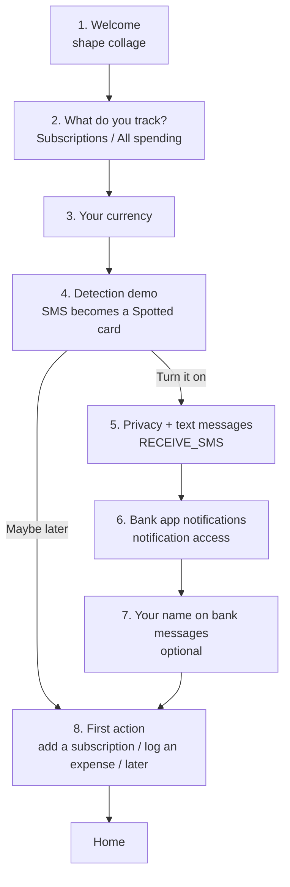

# Onboarding flow: design

Status: design agreed in chat on 2026-10-14 (brainstorming session with the visual companion). Not yet reviewed as a written spec. Next step for a new conversation: review this file, then run the `superpowers:writing-plans` skill on it, then implement.

Mockups from the session (local only, `.superpowers/` is gitignored): `.superpowers/brainstorm/92000-1792000423/content/onboarding-concepts.html` and `welcome-screen.html`.

## 1. Why

First run is currently two unrelated screens that grew one at a time:
- `ModeChooserScreen`: what Subsy tracks.
- `DetectionIntroScreen`: the detection opt-in, which only asks for SMS access.

Meanwhile onboarding now has to carry much more:
- the mode
- the primary currency (today it silently comes from the phone's locale)
- the charge-detection opt-in, with a 98 MB model download
- two permissions: `RECEIVE_SMS` and notification access
- Android's "restricted settings" block, for apps installed outside Play (Subsy ships on GitHub)
- the account holder's name, for own-account transfers

Notification access and the name are currently only reachable from Settings, so most testers would never set them up.

**Who it's for:** testers (the developer's friends), then GitHub users, mostly in Kenya, on Android 13+.

**Success means:**
- A tester finishes in about a minute.
- They understand why each permission is asked.
- If they turn detection on, it actually works at the end: the download has started, both permissions are granted (or knowingly skipped), and their name is set.
- Existing users aren't sent through it again.

## 2. Decisions (all agreed)

| Topic | Decision |
|---|---|
| Overall direction | **Hybrid A + C**: A's one-step-per-screen wizard with M3 Expressive wavy progress; C's "show it, then ask" demo for detection. Mode and currency don't need persuading; detection does. |
| Welcome screen | **Yes, W1 "shape collage"**: four real service logos inside M3 Expressive shapes (cookie, clover, circle…) that slowly morph and drift, headline + one button. |
| Welcome logos | **Bundled as app assets** (works offline, no network on first launch). **Not KPLC.** Services: **Netflix, Spotify, YouTube, ChatGPT**, with Apple Music as the fallback if one of those has no usable icon (see 5.1). |
| Tutorials | **No tutorial screens or coach-mark tours.** The flow ends with the first real action ("Add your first subscription" / "Log your first expense"); empty states already teach. |
| Hidden gestures | **One-time M3 tooltips**, each shown once the first time it's relevant, then never again (section 6). |

## 3. The flow

- One screen per step. Wavy linear progress at the top (`LinearWavyProgressIndicator`, M3 Expressive) on steps 2 to 7, hidden on Welcome and First action.
- Back (including predictive back) goes to the previous step; from Welcome it leaves the app as normal. Each step keeps its answer when you go back.
- Steps 5 to 7 exist only if detection was turned on in step 4.
- Copy follows the antislop rules in force (mode DURING): no em dashes, no emoji, no hype words, no invented numbers, decorative icons get `contentDescription = null`. All strings in `res/values/strings_onboarding.xml` (extend the existing file; reuse `detection_*` strings where they fit).

## 4. Screens

Shared layout (as `ModeChooserScreen` today): full-screen `Surface`, `safeDrawingPadding`, scrollable column, `Spacing.xl` horizontal padding. The step title is `displaySmallEmphasized` with heading semantics. Body is `bodyLarge` in `onSurfaceVariant`. The primary action is a full-width `Button` at the bottom, with a `TextButton` beneath it for skip-type actions. Each step has one hero shape (`MaterialShapes` + `toShape()`) in a colour container: secondary for mode and currency, tertiary for detection steps, primary for privacy and the end.

1. **Welcome.**
   - Four logos (section 5.1), each inside a different `MaterialShapes` shape (Cookie9Sided, Clover4Leaf, Circle, and a fourth such as Sunny or Cookie6Sided) on its brand colour, white glyph. Composition as in the W1 mock: one large, one medium, two small, overlapping.
   - Motion: each shape slowly morphs to a sibling shape and drifts a few dp, on long staggered loops. Use `androidx.graphics.shapes.Morph` (already a dependency: `graphics-shapes`) with the theme's `MaterialTheme.motionScheme` springs. Respect reduced motion: with animator duration scale 0, show the static layout.
   - Headline: "Every renewal, before it charges you". Body: "Subscriptions, trials and bills in one place, with reminders. Kept on this phone." Button: "Get started".
2. **What do you track?** Today's `ModeChooserScreen` content moved into the flow (same `ModeOption` cards, same strings). Button "Continue".
3. **Your currency.**
   - Preselected from the locale, as `SettingsRepository` does today.
   - A `CurrencyPicker`-style choice using `currencyChoices(current)` from `ui/util/Currencies.kt`, with the currency name (`Currency.getDisplayName`) as supporting text.
   - Body: "Totals are shown in it. Charges in other currencies are converted." Button "Continue".
4. **Detection demo ("Never type a charge in again").**
   - A synthetic M-Pesa SMS bubble slides in, then transforms into the real Spotted card, rendered with the production card composable and fake data. Use only synthetic text, for example "UJE1NB2XYZ Confirmed. Ksh1,100.00 sent to M-PESA CARD for account NETFLIX.COM…", never real messages.
   - Motion: slide + fade in for the bubble, then a `SharedTransitionLayout`-style or crossfade + size transform into the card, with spring specs from the motion scheme. Replays once when the step is entered.
   - Body (short): reads new bank and M-Pesa messages and offers one-tap logging, nothing logged without a tap, a %s download over Wi-Fi.
   - Buttons: "Turn it on" (primary) and "Maybe later" (text). "Turn it on" sets detection enabled and calls `ModelRepository.download()` (exactly what `MainActivity`'s `onTurnOn` does now), then goes to step 5. "Maybe later" goes to step 8; Settings still has the switch.
5. **Privacy + text messages ("Your messages stay here").**
   - Body: read on this phone with a model downloaded once; nothing about messages is sent anywhere; only new messages, never old ones.
   - A small status line showing the download state (`ModelRepository.state`: Waiting for Wi-Fi / Downloading N% / Ready).
   - Button "Allow text messages": `RequestPermission(RECEIVE_SMS)`. Text button "Skip".
   - Granted: next step. Denied: see 4.1.
6. **Bank app notifications.**
   - Body: bank and wallet apps send alerts too; this lets Subsy read them the same way.
   - Button "Open settings": `Settings.ACTION_NOTIFICATION_LISTENER_DETAIL_SETTINGS` with Subsy's `BankNotificationListener` component (the `openNotificationAccess` helper in `SettingsScreen.kt`; move it somewhere shared). Text button "Skip".
   - On return (lifecycle resume), re-check `NotificationManagerCompat.getEnabledListenerPackages`: granted, go to the next step; not granted, see 4.1.
7. **Your name on bank messages (optional).**
   - Text field, characters capitalised, hint "As your bank prints it, for example JOHN KAMAU".
   - Body: money to or from this name counts as moving your own money.
   - Button "Continue" saves via `SettingsRepository.setAccountHolderName` if not blank. Text button "Skip".
8. **First action (the "tutorial").**
   - Title: "You're set". Body depends on mode.
   - Subscriptions mode: primary "Add your first subscription", which opens `Screen.AddSubscription` with the preset catalog sheet already open.
   - All spending: primary "Log your first expense", which opens the transaction sheet for a new transaction. Secondary "Add a subscription" goes to Add subscription with the catalog open.
   - Text button "I'll do it later": Home.
   - Finishing the flow marks onboarding done (section 7) before navigating.

### 4.1 Restricted settings and denied permissions
Android 13+ blocks SMS and notification-listener access for apps installed by a browser or file manager ("restricted settings"). The app can't detect this directly. Instead, when a grant attempt comes back not granted:
- **SMS:** the permission result is denied.
- **Notification access:** still not enabled after returning from Android's settings.

In both cases the step shows an inline help card (surfaceContainer, `MaterialTheme.shapes.large`): "If the switch was greyed out or the prompt didn't appear, Android is protecting apps installed outside Play. Open App info, tap the menu in the top corner, then Allow restricted settings, and try again." It has a button "Open App info" (`Settings.ACTION_APPLICATION_DETAILS_SETTINGS` with `package:` URI) and keeps the main button to retry.
- **SMS denied twice:** Android stops showing the prompt, so a third tap would do nothing. When `shouldShowRequestPermissionRationale` is false after a denial, the main button becomes "Open App info" too. Fix the same gap in Settings' "Text messages" row; it's listed in ARCHITECTURE.md 2.18.

## 5. Assets and visuals

### 5.1 Welcome logos (bundled, offline)
- **Preferred source:** Simple Icons (simpleicons.org; the SVG paths are CC0; the trademarks remain their owners'). Convert each SVG to an Android `VectorDrawable` in `res/drawable/onboarding_logo_<service>.xml`, as a single path tinted white, drawn on the brand colour inside the shape. This is sharp at any size and a few KB each.
- **Check each one exists** in the current Simple Icons release before relying on it. Brands are sometimes removed on request, and OpenAI or ChatGPT may be among them. If one is missing, use Apple Music instead.
- **Brand colours:** use the catalog's `PresetService.colorHex` for each service, so the welcome screen matches the rest of the app.
- **Last-resort fallback:** a PNG from the existing favicon source (`BrandLogoResolver.logoUrl`, `https://www.google.com/s2/favicons?domain=…&sz=128`) saved to `res/drawable-nodpi/`. It's 128 px, so slightly soft at the largest shape size.
- **Do not fetch anything at runtime** on the welcome screen.
- **Note in ARCHITECTURE.md:** these are third-party trademarks shown to illustrate the services Subsy tracks, and the credit goes on Settings' attribution row (where ExchangeRate-API is credited).

### 5.2 Motion and colour
- **Springs** come from `MaterialTheme.motionScheme`. Steps change with a shared-axis X transition (slide + fade, forward and back).
- **Colour roles** follow the project's conventions: primary = the hero/positive surface, secondary = choices, tertiary = detection and spending, error only for real errors. Tokens only (`Spacing.*`, `MaterialTheme.shapes.*`), no raw dp for spacing.

## 6. One-time hints (tooltips)
Only for gestures and taps that can't be seen. Each is a rich M3 tooltip (`TooltipBox` + `RichTooltip` + `rememberTooltipState(isPersistent = true)`, positioned with `TooltipDefaults.rememberRichTooltipPositionProvider()`), shown once the first time its anchor is on screen, dismissed by tapping it or doing the gesture, then never shown again.

| Id | Where, anchored to | Text | Shown when |
|---|---|---|---|
| `home_swipe` | Home, the first subscription row | Swipe left to delete, right to pause or resume. | The first time Home lists at least one subscription |
| `transactions_swipe` | Transactions, the first transaction row | Swipe left to delete. | The first time Transactions lists at least one transaction |
| `spending_month_budget` | Spending, the monthly bars | Tap a month to give it its own budget. | The first time the bars are shown with a budget set |

- **Persistence:** a `hints_seen` string set in DataStore (`SettingsRepository`: `hintsSeen: Flow<Set<String>>`, `markHintSeen(id)`).
- **One hint per screen visit, at most.** Hints never appear during onboarding.
- **Small helper:** a composable (for example `OneTimeHint(id, text) { anchor }` in `ui/components/`) wraps the anchor and does the state handling, so screens add one line each.

## 7. State and wiring
- **Replace the two flags** (`appMode == null` and `detectionIntroSeen`) with one: `onboarding_done` in DataStore (`UserSettings.onboardingDone`).
- **Existing installs:**
  - `onboardingDone = prefs[ONBOARDING_DONE] ?: (appMode != null && detectionIntroSeen)`.
  - A user with a mode but without `detectionIntroSeen` starts the flow at step 4 (detection demo), not at Welcome.
- **`MainActivity`:** `current == null` shows nothing (as now); not done shows `OnboardingFlow`; done shows `SubsyNavGraph`. The first action is passed to `SubsyNavGraph` as a one-shot start action (for example `startAction: OnboardingFinish?` = AddSubscription with the catalog open, NewTransaction, or None). The nav graph performs it once after its first composition.
- **`OnboardingViewModel`** (`ui/onboarding/`):
  - holds the current step, the chosen mode, currency, detection on or off, and the name
  - exposes `next()`, `back()`, `skipDetection()`, `finish(action)`
  - writes settings as each step is confirmed (mode, currency, detection plus download, name), so leaving midway keeps what was answered
  - step logic is a pure function `nextStep(step, detectionOn)` for unit tests
- **`AddEditSubscriptionScreen`** needs a way to open with the preset sheet showing, for example a nav argument `openCatalog: Boolean` on `Screen.AddSubscription` (turning that data object into a data class with a default), passed to the screen's `showPresetSheet` initial value.
- **Remove** `DetectionIntroScreen` and the `detectionIntroSeen` setter once the flow replaces them. Keep reading the old key for the migration above.

## 8. Files (expected)
| New | Purpose |
|---|---|
| `ui/onboarding/OnboardingFlow.kt` | Step host: progress, transitions, back handling |
| `ui/onboarding/OnboardingViewModel.kt` | Step state and settings writes |
| `ui/onboarding/steps/*.kt` (or one file per step) | Welcome, Mode (moved from `ModeChooserScreen`), Currency, DetectionDemo, Privacy+SMS, Notifications, Name, FirstAction |
| `ui/onboarding/WelcomeCollage.kt` | Morphing logo shapes |
| `ui/components/OneTimeHint.kt` | Tooltip helper |
| `res/drawable/onboarding_logo_*.xml` | Bundled logos |

Changed: `MainActivity`, `SettingsRepository` (`onboardingDone`, hints), `SubsyNavGraph` (start action), `Screen` (AddSubscription with `openCatalog`), `AddEditSubscriptionScreen`, `HomeScreen` / `TransactionsScreen` / Spending (hints), `SettingsScreen` (shared permission helpers, denied-twice fix), `strings_onboarding.xml`, `ARCHITECTURE.md` (onboarding section, logo attribution note, update 2.13).

## 9. Testing
- **Unit tests:**
  - `nextStep` covers every path (detection on and off, back from each step).
  - `onboardingDone` migration covers: fresh install; mode set with the intro seen; mode set without the intro, which starts at step 4.
  - Hint persistence: shown once, then marked seen.
- **The usual checks:** `ktlintFormat`, then separately `ktlintCheck detekt testDebugUnitTest assembleDebug assembleDebugAndroidTest`.
- **On the S22, by the user:**
  - fresh install: the full path with detection on
  - "Maybe later" path
  - deny SMS once, then twice (the help card, then App info)
  - notification access granted, and skipped
  - back from each step
  - existing-user upgrade (no onboarding, or starts at step 4)
  - each hint appears once
  - reduced motion: static welcome
- **Restricted settings:** to see the real block, install the APK through a file manager rather than adb. Installs from adb or Android Studio aren't restricted.

## 10. Out of scope
- Tutorials or tours of any kind beyond the three hints.
- Changing the Settings detection section, other than the shared helpers and the denied-twice fix.
- Kenyan services in the preset catalog (a separate data task, listed in ARCHITECTURE.md 2.18).
- Custom categories in the subscription form's "Counts under" (listed in 2.18).
